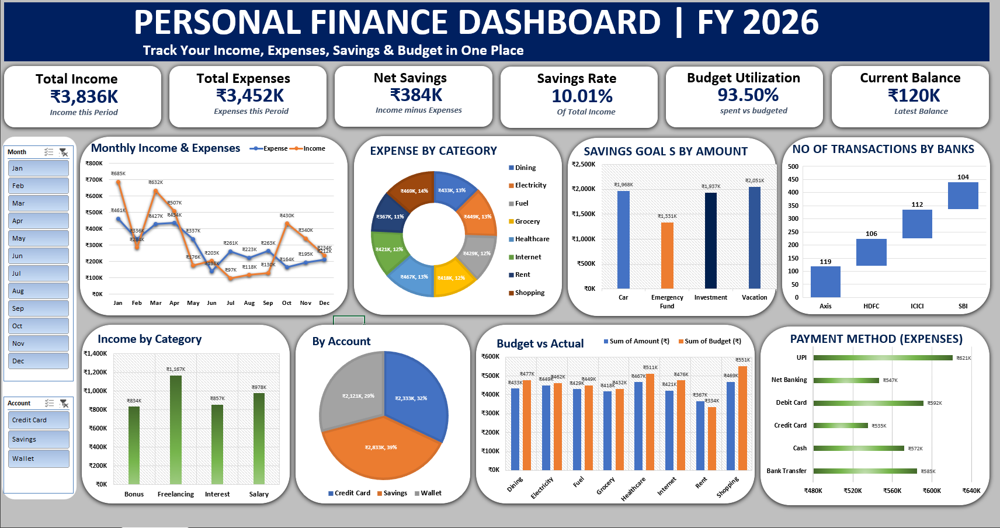

# Personal Finance Dashboard

An Excel practice dashboard that presents income, expenses, savings, budgets, and account views in one workbook. The repository includes a dashboard screenshot and an Excel workbook.

## Preview

## Files

- [Excel dashboard workbook](Dashboard/Personal-Finance-Dashboard.xlsx)
- [Dashboard screenshot](Dashboard.png)

The workbook is an `.xlsx` file. The repository does not include the separately named `Sample_Data.xlsx` referenced in the earlier README, and no VBA macro file or macro-enabled workbook is present. The previous one-click VBA refresh claim is therefore removed.

## Dashboard shown

The screenshot displays KPI cards for income, expenses, net savings, savings rate, budget utilization, and balance, alongside monthly income and expense trends, category breakdowns, savings goals, bank transaction counts, account views, budget comparisons, and payment methods. It also shows month and account filters. These are dashboard contents in the provided screenshot; values are illustrative workbook data and are not a claim about anyone's real finances or a measured business outcome.

## Data and reproducibility

The repository contains the workbook but no separate sample-data file or data provenance note. The workbook's source data, formulas, and refresh behavior have not been independently audited. To review the project, download the workbook and open it in a compatible spreadsheet application. Recalculation and filter behavior may depend on the application and workbook configuration.

## Tools represented

Microsoft Excel workbook with charts and interactive filters, as represented in the screenshot. Specific formulas, PivotTable setup, and automation should be documented only after validating them in the workbook.

---

Independent practice project; not financial advice or client work.
